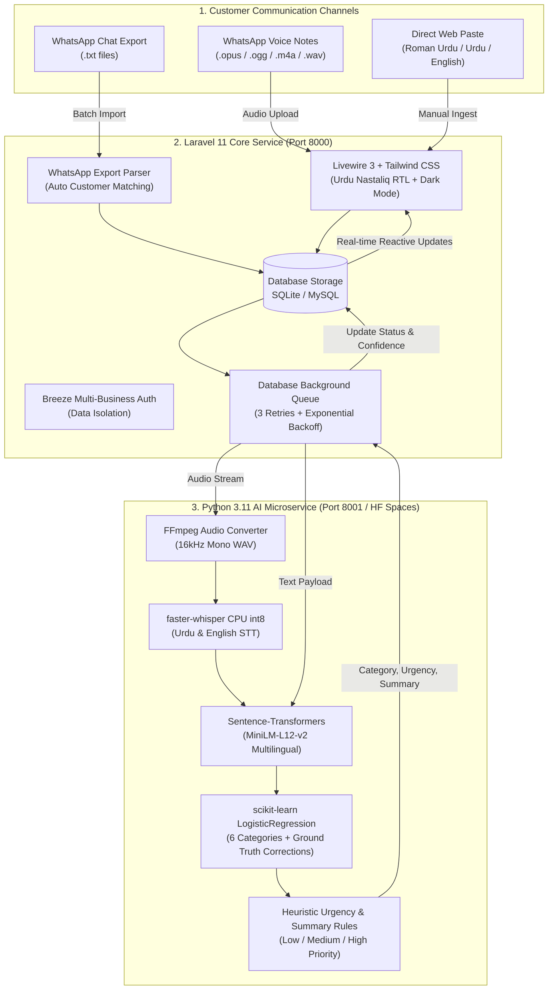

# Fauri (فوری) — Intelligent WhatsApp Message Triage for Pakistani Commerce

<div align="center">
  
  <p><strong>"فوری جواب، مطمئن گاہک"</strong> — Instant Response, Satisfied Customer.</p>
  <p>An autonomous, multi-tenant customer message triage platform built for Pakistani online sellers, clinics, academies, and service businesses dealing with high volumes of Roman Urdu, Urdu Nastaliq, and English voice notes.</p>

  [](https://laravel.com)
  [](https://fastapi.tiangolo.com)
  [](https://github.com/SYSTRAN/faster-whisper)
  [](https://huggingface.co/sentence-transformers/paraphrase-multilingual-MiniLM-L12-v2)
  [](LICENSE)
</div>

---

## 1. System Architecture



---

## 2. Product Features & Design Highlights

- **Bilingual & RTL Aware:** Native support for Urdu script rendered with Google Fonts' `Noto Nastaliq Urdu` with automated right-to-left baseline detection (`dir="rtl"`).
- **Voice Note Transcription:** Seamlessly converts WhatsApp voice notes (`ogg`, `opus`, `mp3`, `m4a`, `wav`) via FFmpeg and transcribes with `faster-whisper` (`int8` quantized for high CPU throughput).
- **Urgency Scoring Engine:** Detects high-priority wedding deadlines, medical emergencies, credit card fraud disputes, and rider delivery delays across Roman Urdu (`"foran dispatch krwaen"`, `"khuda k waste"`), Urdu script (`"فوری ایمرجنسی"`), and English (`"immediate cancellation"`).
- **Active Learning Human Correction:** Business owners can correct any misclassified message with 1 click in the detail drawer, accumulating authentic ground truth for automated weekly retraining.
- **Zero API Costs & Free-Tier Friendly:** 100% CPU execution requiring < 1.5GB RAM footprint, zero paid LLM tokens, zero recurring cloud subscriptions.

---

## 3. UI/UX Walkthrough & Screenshots

```text
┌──────────────────────────────────────────────────────────────────────────────────────────────────┐
│  [ Fauri فوری ]   Dashboard   Customers                       [ Gulberg Apparel ]  [ EN / اردو ] │
├──────────────────────────────────────────────────────────────────────────────────────────────────┤
│                                                                                                  │
│   ┌─────────────────┐   ┌─────────────────┐   ┌─────────────────┐   ┌─────────────────┐          │
│   │  Today's Feed   │   │ Urgent Attention│   │ Pending Triage  │   │    Resolved     │          │
│   │       20        │   │    3 CRITICAL   │   │       11        │   │        9        │          │
│   └─────────────────┘   └─────────────────┘   └─────────────────┘   └─────────────────┘          │
│                                                                                                  │
│  🚨 TOP CRITICAL FEED:                                                                           │
│  • Fatima Zahra: "URGENT: kal meri shadi ka event hai bridal dress abhi tak receive nahi hua!"   │
│  • Dr. Asim Farooq: "فوری ایمرجنسی ہے مریض کو دوائی کا شدید ری ایکشن ہوا ہے..."                 │
│                                                                                                  │
│  📊 CATEGORY SPECTRUM:                                                                           │
│  [■■■ Orders 35%] [■■ Complaints 20%] [■■ Refunds 15%] [■ Urgent 15%] [■■ Inquiries 15%]        │
│                                                                                                  │
│  📥 TRIAGE INBOX:                                                                                │
│  [ Search Roman Urdu or English... ] [ Category: All ▾ ] [ Urgency: All ▾ ] [ Status: All ▾ ]    │
│  ──────────────────────────────────────────────────────────────────────────────────────────────  │
│  [✓] Hamza Sheikh  • DHA Lahore   "AOA bhai black linen suit medium size COD pe..."  [Pending ▾] │
│  [✓] Sana Mir      • Voice Note   "bhai royal blue mangwaya tha brown bhej dia..."   [In Progress│
│  [✓] Bilal Ahmed   • Leopard TCS  "return deliver ho gya 4200 JazzCash pe bhejo"     [Resolved]  │
└──────────────────────────────────────────────────────────────────────────────────────────────────┘
```

---

## 4. Quickstart: One-Command Local Setup

You can run both the Laravel web application and the Python AI service using Docker Compose:

```bash
docker compose up --build
```

- **Web Application & Dashboard:** [http://localhost:8000](http://localhost:8000)
  - Demo Account: `demo@fauri.pk`
  - Demo Password: `password`
- **AI Microservice & Health Probe:** [http://localhost:8001/health](http://localhost:8001/health)

---

## 5. Manual Local Development

### 1. AI Service Setup
```bash
cd ai-service

# Install dependencies
pip install -r requirements.txt

# (Optional) Set shared-secret API key for endpoint authentication
export AI_API_KEY=fauri_super_secret_key_change_me

# Set Whisper model size (defaults to 'small', falls back to 'tiny' only if disk < 1.5GB)
export WHISPER_MODEL=small

# Train baseline classifier or retrain with human-verified corrections from SQLite DB
python train.py
python train.py --retrain

# Run tests (17 unit, auth, and negation tests)
pytest tests/ -v

# Start FastAPI server
uvicorn app.main:app --host 127.0.0.1 --port 8001
```

### 2. Laravel Web Setup
```bash
cd web

# Install PHP dependencies
composer install

# Install Node dependencies and compile assets
npm install
npm run build

# Configure environment
cp .env.example .env
php artisan key:generate

# Set shared-secret API key to authenticate with AI service
# In .env: AI_SERVICE_KEY=fauri_super_secret_key_change_me

# Run migrations and seed Pakistani SMB demo data (local only)
php artisan migrate --seed

# Run Laravel test suite (33 feature & unit tests)
php artisan test

# Start background queue worker (or set QUEUE_CONNECTION=sync for instant local triage)
php artisan queue:work --tries=3

# Start development server
php artisan serve --port=8000
```

---

## 6. Model Training & Accuracy Benchmark

- **Dataset:** 600 balanced synthetic messages in Roman Urdu, Urdu script, and English (`ai-service/data/messages.csv`).
- **Embedding Model:** `sentence-transformers/paraphrase-multilingual-MiniLM-L12-v2` (384-dimensional).
- **Classifier:** scikit-learn `LogisticRegression(C=2.0)`.
- **Artifact Packaging:** `ai-service/models/classifier.pkl` is **committed directly to the Git repository** and copied into the Docker image at build time. It is **not** trained during `docker build`, ensuring fast, deterministic, reproducible image builds without internet access or GPU dependencies.
- **Active Retraining:** Merchants can correct misclassifications in the Livewire UI (`is_verified = true`), and retrain via `python train.py --retrain`.

```text
============================================================
TRAIN ACCURACY: 99.58%
TEST ACCURACY:  84.17% (Stratified 80/20 Test Split)
============================================================

               precision    recall  f1-score   support
   complaint      0.8667    0.6500    0.7429        20
     inquiry      0.8571    0.9000    0.8780        20
       order      0.8261    0.9500    0.8837        20
       other      0.7917    0.9500    0.8636        20
      refund      0.8000    0.8000    0.8000        20
      urgent      0.9412    0.8000    0.8649        20
    accuracy                          0.8417       120
```

> **Note on Real-World Accuracy & Negation:** Real WhatsApp messages feature complex Roman Urdu negation (`"deliver nahi hua"`, `"cancel na karein"`, `"replacement nahi chahiye"`). Fauri incorporates dedicated semantic negation rules in `ai-service/app/rules.py` that preserve negation tokens and prevent false `order` or `refund` classifications.

---

## 7. Free Production Deployment

See [DEPLOY.md](file:///c:/Users/Abdullah/Desktop/PSL%20ANALYZER/DEPLOY.md) for step-by-step instructions:
- **AI Service:** Hosted on Hugging Face Spaces (Docker SDK, port 7860, free 16GB CPU, secured via `AI_API_KEY`).
- **Web App:** Hosted on Render.com (`render.yaml` free tier blueprint with zero paid background workers, `QUEUE_CONNECTION=sync` for instant triage or external cron via `queue:work --stop-when-empty`).
- **Database:** Free Cloud MySQL via TiDB Cloud Serverless (5GB free) or Aiven MySQL (5GB free).

---

## 8. Brand Identity

See [BRAND.md](file:///c:/Users/Abdullah/Desktop/PSL%20ANALYZER/BRAND.md) for the complete design system, typography rationale, and brand naming etymology.

---

## 9. Known Limitations & Production Caveats

1. **Whisper "small" CPU Speed (~15–25s latency):** On CPU without CUDA hardware acceleration, `faster-whisper-small` (int8 quantized) requires approximately 15–25 seconds of processing time per 6–8 second WhatsApp audio clip. For production, voice note transcription should always be dispatched via the asynchronous Laravel queue (`TranscribeAudioJob`) or queued workers.
2. **TTS-Only Synthetic Audio Testing:** Speech-to-text accuracy verification was conducted using synthetic Pakistani neural TTS voices (`ur-PK-UzmaNeural`, `ur-PK-AsadNeural`). Real-world voice notes recorded via low-cost mobile phone microphones with ambient Pakistani bazaar/traffic background noise, heavy accents, and noisy Roman Urdu code-switching will exhibit higher Word Error Rates (WER). A repeat-token loop guard, temperature fallback (0.2), and a clear UI notice (`🎙️ Auto-transcribed, please verify`) have been implemented.
3. **Docker Untested on Host:** Docker deployment assets (`Dockerfile`, `ai-service/Dockerfile`, `docker-compose.yml`) are fully authored according to standard Linux containerization practices, but the Docker daemon was not directly tested or executed on the local Windows host environment during development.
4. **Render Free Tier Ephemeral Storage:** Containers on Render Free spin down on 15 minutes of inactivity, resetting SQLite databases and local audio uploads. Persistent external MySQL (TiDB / Aiven) and S3/R2 object storage are documented in [DEPLOY.md](file:///c:/Users/Abdullah/Desktop/PSL%20ANALYZER/DEPLOY.md).

